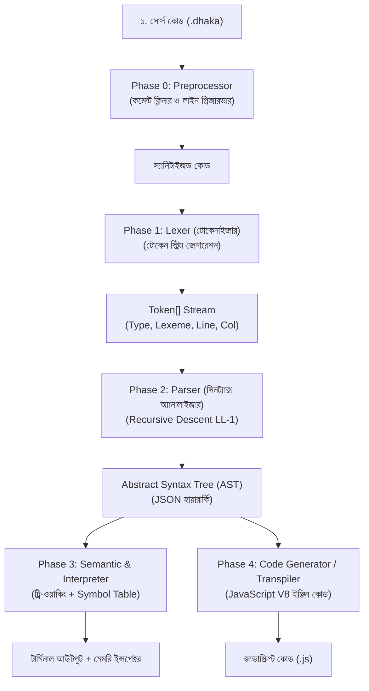
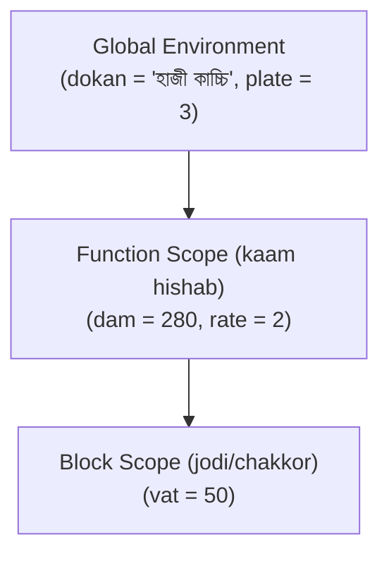

# 🛺 DhakaiyaLang (পুরান ঢাকা) — সম্পূর্ণ প্রজেক্ট ডকুমেন্টেশন ও আর্কিটেকচার গাইড

**কোর্স:** CSE 3202: Compiler Design Sessional  
**প্রজেক্ট নাম:** DhakaiyaLang (ঢাকাইয়া ল্যাং)  
**অনুপ্রেরণা:** Bhailang, BongLang, এবং পুরান ঢাকার ঐতিহ্যবাহী কথ্য ভাষা  
**ইমপ্লিমেন্টেশন টেকনোলজি:** Pure TypeScript / Modern JavaScript (ES6+), Next.js 14, Tailwind CSS  
**টার্গেট আর্কিটেকচার:** Client-side V8 Engine & Web IDE

---

## 📑 সূচিপত্র (Table of Contents)
1. [প্রজেক্ট ওভারভিউ (Project Overview)](#১-প্রজেক্ট-ওভারভিউ)
2. [ল্যাঙ্গুয়েজ স্পেসিফিকেশন ও ব্যাকরণ (EBNF Grammar)](#২-ল্যাঙ্গুয়েজ-স্পেসিফিকেশন-ও-ব্যাকরণ)
3. [কম্পাইলার পাইপলাইন আর্কিটেকচার (5-Phase Pipeline)](#৩-কম্পাইলার-পাইপলাইন-আর্কিটেকচার)
   - [Phase 0: প্রিপ্রসেসর (Preprocessor)](#phase-0-প্রিপ্রসেসর-preprocessor)
   - [Phase 1: লেক্সিক্যাল অ্যানালাইজার (Lexer / Tokenizer)](#phase-1-লেক্সিক্যাল-অ্যানালাইজার-lexer)
   - [Phase 2: সিনট্যাক্স অ্যানালাইজার (Parser & AST)](#phase-2-সিনট্যাক্স-অ্যানালাইজার-parser)
   - [Phase 3: সিম্যান্টিক অ্যানালাইজার ও ইন্টারপ্রেটার (Semantic & Interpreter)](#phase-3-সিম্যান্টিক-অ্যানালাইসিস-ও-ইন্টারপ্রেটার)
   - [Phase 4: কোড জেনারেটর / ট্রান্সপাইলার (V8 JS Transpiler)](#phase-4-কোড-জেনারেটর--ট্রান্সপাইলার)
4. [জাভাস্ক্রিপ্ট ব্যাকগ্রাউন্ডে কীভাবে কাজ করছে? (How JS Works Under the Hood)](#৪-জাভাস্ক্রিপ্ট-ব্যাকগ্রাউন্ডে-কীভাবে-কাজ-করছে)
5. [আমি কেমনে কি করছি? (Step-by-Step Implementation Guide)](#৫-আমি-কেমনে-কি-করছি-বাস্তবায়ন-বিবরণ)
6. [ওয়েব আইডিই ও ইউআই আর্কিটেকচার (Next.js & Studio)](#৬-ওয়েব-আইডিই-ও-ইউআই-আর্কিটেকচার)
7. [পরীক্ষার ভাইভা ও ডিফেন্সের প্রস্তুতি (Viva Defense Q&A)](#৭-পরীক্ষার-ভাইভা-ও-ডিফেন্সের-প্রস্তুতি)
8. [প্রোজেক্ট স্ট্রাকচার (Repository Layout)](#৮-প্রোজেক্ট-স্ট্রাকচার-repository-layout)

---

## ১. প্রজেক্ট ওভারভিউ

### ১.১ প্রজেক্টের লক্ষ্য
**DhakaiyaLang** হলো পুরান ঢাকার ৪০০ বছরের রসাত্মক ও ঐতিহ্যবাহী মুখের ভাষার আদলে তৈরি একটি আধুনিক Toy Programming Language। এটি তৈরি করা হয়েছে **CSE 3202: Compiler Design Sessional** ল্যাবের জন্য, যার মূল উদ্দেশ্য হলো একটি প্রোগ্রামিং ল্যাঙ্গুয়েজ একদম শূন্য থেকে শুরু করে কীভাবে স্ক্র্যাচ লেভেলে তৈরি হয় তা হাতে-কলমে প্রমাণ করা।

### ১.২ মূল বৈশিষ্ঠ্যসমূহ
- **জিরো এক্সটার্নাল ডিপেন্ডেন্সি:** কোনো থার্ড-পার্টি পার্সার জেনারেটর (যেমন Lex, Yacc, ANTLR, Babel) ছাড়া সম্পূর্ণ হ্যান্ড-ক্রাফটেড কোডে তৈরি।
- **ডুয়াল এক্সিকিউশন ইঞ্জিন (Dual Engine):**
  1. *AST Tree-Walking Interpreter:* সরাসরি ট্রি ট্রাভার্সাল করে এক্সিকিউট করে এবং লাইভ সিম্বল টেবিল বানায়।
  2. *V8 Transpiler:* DhakaiyaLang কোডকে হাই-পারফরম্যান্স সমতুল্য জাভাস্ক্রিপ্টে রূপান্তর করে।
- **সম্পূর্ণ ওয়েব বেসড স্টুডিও:** Next.js 14-এ তৈরি লাইভ টার্মিনাল, লাইভ মেমরি সিম্বল টেবিল, টোকেন স্ট্রিম টেবিল, এবং AST ট্রি ভিউয়ার।

---

## ২. ল্যাঙ্গুয়েজ স্পেসিফিকেশন ও ব্যাকরণ

### ২.১ কী-ওয়ার্ড ম্যাপিং (Keyword Mappings)

| DhakaiyaLang Keyword | Standard Equivalent (JS/C) | অর্থ / কাজ |
| :--- | :--- | :--- |
| `bismillah` | `program_start` / `main() {` | প্রোগ্রামের সূচনা |
| `khatam` | `program_end` / `}` | প্রোগ্রামের সমাপ্তি |
| `rakh` | `let` / `var` | ভ্যারিয়েবল ডিক্লেয়ারেশন |
| `chilla` | `console.log` / `printf` | টার্মিনালে প্রিন্ট করা |
| `jodi` | `if` | শর্তাধীন স্টেটমেন্ট |
| `naile` | `else` | বিকল্প শর্তাধীন স্টেটমেন্ট |
| `chakkor` | `while` loop | পুনরাবৃত্তিমূলক লুপ |
| `kaam` | `function` | ফাংশন ডিক্লেয়ারেশন |
| `ferot` | `return` | মান ফেরত পাঠানো |
| `thamo` | `break` | লুপ তাৎক্ষণিক বন্ধ করা |
| `chalao` | `continue` | লুপের পরবর্তী ইটারেশনে যাওয়া |
| `asli` | `true` | সত্য বুলিয়ান মান |
| `fapor` | `false` | মিথ্যা বুলিয়ান মান |
| `khali` | `null` | নাল বা ফাঁকা মান |
| `ebong` | `&&` | লজিক্যাল অ্যান্ড (AND) |
| `othoba` | `\|\|` | লজিক্যাল অর (OR) |
| `nah` | `!` | লজিক্যাল নট (NOT) |
| `[ ... ]` | Array (`dekchi`) | মেমোরিতে অ্যারে তালিকা |

---

### ২.২ EBNF ব্যাকরণ (Extended Backus-Naur Form)

```ebnf
Program             ::= "bismillah" StatementList "khatam" EOF ;

StatementList       ::= Statement* ;

Statement           ::= VarDeclaration
                      | AssignmentStatement
                      | PrintStatement
                      | IfStatement
                      | WhileStatement
                      | FunctionDeclaration
                      | ReturnStatement
                      | BreakStatement
                      | ContinueStatement
                      | BlockStatement
                      | ExpressionStatement ;

VarDeclaration      ::= "rakh" IDENTIFIER ( "=" Expression )? ";" ;

AssignmentStatement ::= ( IDENTIFIER | MemberExpression ) "=" Expression ";" ;

PrintStatement      ::= "chilla" Expression ";" ;

IfStatement         ::= "jodi" "(" Expression ")" BlockStatement ( "naile" ( IfStatement | BlockStatement ) )? ;

WhileStatement      ::= "chakkor" "(" Expression ")" BlockStatement ;

FunctionDeclaration ::= "kaam" IDENTIFIER "(" ParameterList? ")" BlockStatement ;

ParameterList       ::= IDENTIFIER ( "," IDENTIFIER )* ;

ReturnStatement     ::= "ferot" Expression? ";" ;

BreakStatement      ::= "thamo" ";" ;

ContinueStatement   ::= "chalao" ";" ;

BlockStatement      ::= "{" Statement* "}" ;

ExpressionStatement ::= Expression ";" ;

Expression          ::= LogicalOrExpression ;

LogicalOrExpression ::= LogicalAndExpression ( "othoba" LogicalAndExpression )* ;

LogicalAndExpression::= EqualityExpression ( "ebong" EqualityExpression )* ;

EqualityExpression  ::= RelationalExpression ( ( "==" | "!=" ) RelationalExpression )* ;

RelationalExpression::= AdditiveExpression ( ( "<" | "<=" | ">" | ">=" ) AdditiveExpression )* ;

AdditiveExpression  ::= MultiplicativeExpression ( ( "+" | "-" ) MultiplicativeExpression )* ;

MultiplicativeExpr  ::= UnaryExpression ( ( "*" | "/" | "%" ) UnaryExpression )* ;

UnaryExpression     ::= ( "-" | "nah" ) UnaryExpression | PrimaryExpression ;

PrimaryExpression   ::= NUMBER
                      | STRING
                      | "asli"
                      | "fapor"
                      | "khali"
                      | ArrayLiteral
                      | FunctionCallOrVar
                      | "(" Expression ")" ;

ArrayLiteral        ::= "[" ( Expression ( "," Expression )* )? "]" ;

FunctionCallOrVar   ::= IDENTIFIER ( "(" ArgumentList? ")" | "[" Expression "]" )* ;

ArgumentList        ::= Expression ( "," Expression )* ;
```

---

## ৩. কম্পাইলার পাইপলাইন আর্কিটেকচার

আমাদের কম্পাইলার পাইপলাইনটি মোট ৫টি ধাপে (5 Phases) বিভক্ত:



---

### Phase 0: প্রিপ্রসেসর (Preprocessor)
- **ফাইল:** `src/engine/preprocessor.ts`
- **কাজ:** 
  1. কোডের সিঙ্গেল লাইন কমেন্ট (`// ...`) এবং মাল্টি-লাইন কমেন্ট (`/* ... */`) মুছে ফেলা।
  2. তবে কোনো কমেন্ট যদি স্ট্রিং লিটারেলের ভেতরে থাকে (যেমন `"// এটা কমেন্ট না"`), সেটিকে সুরক্ষিত রাখা।
  3. লাইন নম্বর ঠিক রাখার জন্য মাল্টি-লাইন কমেন্ট মুছলেও তার ভেতরে থাকা নিউলাইন (`\n`) অক্ষুণ্ণ রাখা হয়, যাতে এরর হলে পার্সার সঠিক লাইন নম্বর দেখাতে পারে।

```typescript
// অ্যালগরিদম স্নsnippet
if (sourceCode[i] === '/' && sourceCode[i + 1] === '/') {
  while (i < len && sourceCode[i] !== '\n') i++;
  continue;
}
```

---

### Phase 1: লেক্সিক্যাল অ্যানালাইজার (Lexer)
- **ফাইল:** `src/engine/lexer.ts`
- **কাজ:** প্রিপ্রসেসড ক্যারেক্টার স্ট্রিমকে ছোট ছোট অর্থপূর্ণ টোকেনে (Tokens) রূপান্তর করা।
- **টোকেন অবজেক্টের গঠন:**
  ```typescript
  class Token {
    type: string;     // যেমন: VAR, IDENTIFIER, NUMBER, PLUS
    value: any;       // যেমন: 'rakh', 'plate', 280, '+'
    line: number;     // কোডের লাইন নম্বর
    column: number;   // কোডের কলাম নম্বর
  }
  ```
- **লেক্সার যেভাবে কাজ করে:**
  - কার্সার (`cursor`) দিয়ে প্রতি ক্যারেক্টার রিড করে।
  - যদি অক্ষর বা আন্ডারস্কোর পায়, তবে আইডেন্টিফায়ার বা কী-ওয়ার্ড রিড করে।
  - যদি সংখ্যা পায়, দশমিক নম্বর রিড করে।
  - কোটেশন (`"` বা `'`) পেলে স্ট্রিং লিটারেল তৈরি করে।
  - সবশেষে ফাইলে কোনো অবৈধ ক্যারেক্টার থাকলে বিস্তারিত এরর মেসেজ দেয়: `[Lexical Error] মামা! '${ch}' এটা আবার কোন দেশের চিহ্ন?!`।

---

### Phase 2: সিনট্যাক্স অ্যানালাইজার (Parser)
- **ফাইল:** `src/engine/parser.ts`
- **অ্যালগরিদম:** Recursive Descent LL(1) Parser with Precedence Climbing
- **কাজ:** টোকেন স্ট্রিম ব্যাকরণ মেনে চলেছে কিনা যাচাই করা এবং একটি Abstract Syntax Tree (AST) গঠন করা।
- **কীভাবে ব্যাকরণ চেক করে?**
  1. প্রোগ্রাম অবশ্যই `bismillah` টোকেন দিয়ে শুরু হতে হবে।
  2. এরপর লুপ চালিয়ে স্টেটমেন্ট পার্স করে (`this.statement()`)।
  3. শেষ টোকেন অবশ্যই `khatam` হতে হবে।
  4. স্টেটমেন্টের শেষে সেমিকোলন (`;`) না থাকলে পার্সার এরর নিক্ষেপ করে: `"মামা, লাইনের শেষে সেমিকোলন (;) কই?"`।

#### অপারেটর প্রায়োরিটি (Operator Precedence):
```
1. Logical OR (othoba)                [Lowest]
2. Logical AND (ebong)
3. Equality (==, !=)
4. Relational (<, <=, >, >=)
5. Additive (+, -)
6. Multiplicative (*, /, %)
7. Unary (nah, -)                     [Highest]
```

#### AST নোডের নমুনা (Sample AST Node):
```json
{
  "type": "VariableDeclaration",
  "identifier": "dam",
  "init": {
    "type": "Literal",
    "value": 280,
    "raw": "280"
  },
  "line": 3
}
```

---

### Phase 3: সিম্যান্টিক অ্যানালাইসিস ও ইন্টারপ্রেটার
- **ফাইল:** `src/engine/interpreter.ts`
- **আর্কিটেকচার:** Tree-Walking Interpreter + Lexical Environment (Symbol Table)
- **কাজ:** পার্সারের তৈরি AST ট্রির রুট থেকে নোড ধরে ধরে ইভালুয়েট করা।

#### সিম্বল টেবিল (Environment & Lexical Scope):
আমরা একটি ক্লাস `Environment` তৈরি করেছি যাতে রয়েছে:
- `records`: ভ্যারিয়েবল নেম ও মানের একটি `Map<string, any>`।
- `parent`: প্যারেন্ট স্কোপের রেফারেন্স।



- **লুকআপ মেকানিজম (Scope Resolution):**
  একটি ভ্যারিয়েবল খোঁজার সময় প্রথমে বর্তমান স্কোপে খোঁজা হয়। না পেলে `this.parent.lookup(name)` দিয়ে ধাপে ধাপে গ্লোবাল স্কোপ পর্যন্ত খুঁজে দেখা হয়। যদি কোথাও না পাওয়া যায়, তবে এরর দেওয়া হয়:
  `[Runtime Error] মামা, '${name}' নামের কোনো ভ্যারিয়েবল খুইজা পাইলাম না!`।

---

### Phase 4: কোড জেনারেটর / ট্রান্সপাইলার
- **ফাইল:** `src/engine/transpiler.ts`
- **টার্গেট:** Standard ECMAScript (JavaScript / Node / V8)
- **কাজ:** AST গ্রহণ করে সেটি থেকে ক্লিন, প্রফেশনালি ইনডেন্টেড জাভাস্ক্রিপ্ট কোড তৈরি করে।
- **কী-ওয়ার্ড ট্রান্সলেশন:**
  - `rakh a = 10;` $\rightarrow$ `let a = 10;`
  - `chilla a;` $\rightarrow$ `console.log(a);`
  - `jodi (x) { ... } naile { ... }` $\rightarrow$ `if (x) { ... } else { ... }`
  - `chakkor (x > 0)` $\rightarrow$ `while (x > 0)`
  - `kaam jog(a, b)` $\rightarrow$ `function jog(a, b)`
  - `asli` / `fapor` / `khali` $\rightarrow$ `true` / `false` / `null`
  - `ebong` / `othoba` / `nah` $\rightarrow$ `&&` / `||` / `!`

---

## ৪. জাভাস্ক্রিপ্ট ব্যাকগ্রাউন্ডে কীভাবে কাজ করছে?

অনেক শিক্ষার্থীর মনে প্রশ্ন আসে: *"ব্রাউজারে কোনো সি++ কম্পাইলার ছাড়া আমার কোড রান হচ্ছে কীভাবে?"*

### রহস্য: Pure JavaScript AST Execution
১. **ব্রাউজারের V8 ইঞ্জিন:**  
   আধুনিক ব্রাউজার (Chrome, Edge, Firefox) নিজেই একটি হাইপার-ফাস্ট জাভাস্ক্রিপ্ট ইঞ্জিন (যেমন গুগল ক্রোমের V8)। যেহেতু আমাদের সম্পূর্ণ কম্পাইলার পাইপলাইন (Lexer, Parser, Interpreter, Transpiler) খাঁটি জাভাস্ক্রিপ্টে লেখা, তাই ব্রাউজারের নিজস্ব জাভাস্ক্রিপ্ট ভার্চুয়াল মেশিন আমাদের কোডকে প্রসেস করে।

২. **মেমোরিতে এক্সিকিউশন:**  
   - ব্যবহারকারী যখন এডিটরে কোড লিখে `চালাও মামা! 🚀` বাটনে চাপেন, ব্রাউজারের মেইন থ্রেডে `runDhakaiya(sourceCode)` ফাংশনটি কল হয়।
   - কোডটি কোনো ফাইলে সেভ না হয়ে সম্পূর্ণ র্যামের (RAM) মেমোরিতে টোকেনাইজড হয়, ট্রি তৈরি হয় এবং ইন্টারপ্রেটার সরাসরি ফাংশন কল দিয়ে রেজাল্ট বের করে।
   - পুরো প্রসেস সম্পন্ন হতে সময় লাগে মাত্র **১ থেকে ৫ মিলিসেকেন্ড**!

৩. **কনসোল ইন্টারসেপশন:**  
   `chilla` রান করার সময় ব্রাউজারের সাধারণ কনসোল হাইজ্যাক না করে, আমাদের ইন্টারপ্রেটারে একটি কাস্টম `outputCallback` পাঠানো হয় যা সরাসরি আমাদের ইউআই টার্মিনাল অ্যারেতে পুশ করে লাইভ স্ক্রিনে প্রিন্ট করে।

---

## ৫. আমি কেমনে কি করছি? (বাস্তবায়ন বিবরণ)

প্রজেক্টটি তৈরি করার সময় আমরা ধাপে ধাপে যে কাজগুলো করেছি:

### ধাপ ১: ডায়ালেক্ট ও কী-ওয়ার্ড ডিজাইন
পুরান ঢাকার ভাষার স্বাভাবিক টোন পর্যবেক্ষণ করে কী-ওয়ার্ডগুলো নির্ধারণ করি:
- প্রোগ্রাম শুরুতে বিসমিল্লাহ (`bismillah`), শেষে খতম (`khatam`)।
- মান রাখা বোঝাতে `rakh`, চিৎকার করে জানানো বা প্রিন্ট বোঝাতে `chilla`।
- লুপের জন্য চক্কর মারা থেকে `chakkor`, থামা থেকে `thamo`।
- ফাংশন এর কাজের জন্য `kaam`, ফেরত পাঠানোর জন্য `ferot`।

### ধাপ ২: কোর ইঞ্জিন তৈরি (Typescript Engine)
- প্রথমে `preprocessor.ts` লিখে কমেন্ট ফিল্টারিং সমাধান করি।
- এরপর `lexer.ts` লিখে প্রতিটি অক্ষরের জন্য স্টেট মেশিন ও টোকেনাইজার তৈরি করি।
- `parser.ts` তৈরি করে LL(1) ব্যাকরণ ইমপ্লিমেন্ট করি যা গ্রামার এরর খুব সুন্দর বাংলা ভাষায় মেসেজ আকারে আউটপুট দেয়।
- `interpreter.ts` এর ভেতরে মেমরি স্কোপিং ও সিম্বল টেবিল লজিক লিখি।

### ধাপ ৩: এরর হ্যান্ডলিং সিস্টেম (Friendly Error Reporting)
কম্পাইলারের প্রতিটি ধাপে নির্দিষ্ট এরর ক্যাচার রাখা হয়েছে:
- **Lexical Error:** অপরিচিত চিহ্ন এলে কলাম ও লাইন নম্বরসহ এরর।
- **Syntax Error:** সেমিকোলন, ব্র্যাকেট বা কী-ওয়ার্ড মিসিং থাকলে সঠিক নির্দেশনা।
- **Runtime Error:** ভ্যারিয়েবল ডিক্লেয়ার করার আগে ব্যবহার করলে উপযুক্ত সতর্কতা।

---

## ৬. ওয়েব আইডিই ও ইউআই আর্কিটেকচার

আমাদের ওয়েব ইন্টারফেসটি `src/app/page.tsx`-এ ৩টি সুনির্দিষ্ট সেকশনে তৈরি:

### সেকশন ১: হিরো (Hero Section)
- **ব্যাকগ্রাউন্ড:** পুরান ঢাকার সান্ধ্যকালীন রোমান্টিক আবহাওয়া (Unsplash ছবি) ও ডার্ক ওভারলে।
- **আর্টওয়ার্ক:** লালবাগ কেল্লা, আহসান মঞ্জিল ও ইউনেস্কো রিকশা আর্টের ভেক্টর সিলুয়েট।
- **প্রজেক্ট ডিটেইলস:** CSE 3202 ল্যাব প্রজেক্টের সংক্ষিপ্ত বিবরণ ও লাইভ কোড প্রিভিউ কার্ড।

### সেকশন ২: টার্মিনাল ও প্লেগ্রাউন্ড (Terminal & Workbench)
- **অ্যাটমোস্ফিয়ারিক ব্যাকগ্রাউন্ড:** ডার্ক হিরো থিম ও সফট অ্যাম্বিয়েন্ট গ্লো।
- **টুলবার:** ৬টি রেডিমেড ডেমো প্রিসেট ও এক ক্লিকে কোড লেখার স্নsnippet বার।
- **কাচ্চির ডেকচি মিটার:** কোড লাইন সংখ্যা, টোকেন সংখ্যা, AST নোড সংখ্যা এবং রানটাইম (ms) লাইভ মিটার।
- **মাল্টি-ট্যাব স্টুডিও:**
  1. *📟 টার্মিনাল:* লাইভ আউটপুট ও স্ট্যাটাস ব্যাজ।
  2. *📦 সিম্বল টেবিল:* মেমরিতে কোন ভ্যারিয়েবলের কী মান ও টাইপ আছে তার ছক।
  3. *🔍 টোকেন স্ট্রিম:* ফিল্টারেবল টোকেন টেবিল।
  4. *🌳 AST ট্রি:* পুরো প্রোগ্রামের সিনট্যাক্স ট্রি (JSON ফরম্যাটে)।
  5. *⚡ V8 JS:* সমতুল্য জাভাস্ক্রিপ্ট কোড।
  6. *🛠️ Phase 0:* কমেন্ট-মুক্ত প্রিপ্রসেসড কোড।

### সেকশন ৩: ডকুমেন্টেশন (Bhailang Style Cards on Blueprint Grid)
- **ব্যাকগ্রাউন্ড:** টেকনিক্যাল ব্লুপ্রিন্ট গ্রিড পেপার প্যাটার্ন (`assets/grid_bg.png`)।
- **কার্ড ভিউ:** Bhailang এর অফিসিয়াল সাইটের মতো মোট ৮টি ক্যাটাগরি কার্ড।
- **এক-ক্লিকে কপি:** প্রতিটি কার্ডের শীর্ষে "📋 কপি কোড" বাটন রয়েছে যা ক্লিপবোর্ডে কপি করে এবং "কপি হইছে! ✓" ফিডব্যাক দেয়। সাথে "এডিটরে চালান ⚡" বাটনে ক্লিক করলে কোডটি সরাসরি এডিটরে লোড হয়ে রান হয়।

---

## ৭. পরীক্ষার ভাইভা ও ডিফেন্সের প্রস্তুতি

স্যাররা ভাইভায় যেসব প্রশ্ন ধরতে পারেন এবং তার টেকনিক্যাল উত্তর:

### প্রশ্ন ১: তোমাদের পার্সারটা কোন ধরনের পার্সার? (Top-Down নাকি Bottom-Up?)
> **উত্তর:**  
> "স্যার, আমাদের পার্সারটি একটি **Top-Down, Recursive-Descent LL(1) Parser**। এটি প্রোগ্রামের মূল রুট (`bismillah`) থেকে শুরু করে ক্রমান্বয়ে স্টেটমেন্ট এবং এক্সপ্রেশনের দিকে অগ্রসর হয়। এখানে আমরা ১টি টোকেন লুক-অ্যাহেড (`peek()`) দেখে ব্যাকরণগত সিদ্ধান্ত নিই।"

### প্রশ্ন ২: অপারেটর প্রেসিডেন্স (Operator Precedence) কীভাবে হ্যান্ডেল করেছো?
> **উত্তর:**  
> "স্যার, আমরা **Precedence Climbing** এবং গ্রামার রুলসের হায়ারার্কিক্যাল নেস্টিংয়ের মাধ্যমে প্রেসিডেন্স হ্যান্ডেল করেছি। সবার নিচে থাকে Logical OR (`othoba`), তার উপরে Logical AND (`ebong`), তার উপরে Equality ও Relational, এবং সবার শীর্ষে থাকে Multiplicative (`*`, `/`, `%`) ও Unary অপারেটর। ফলে গণিতের নিয়ম অনুযায়ী `2 + 3 * 4` দিলে আগে গুণের কাজ শেষ হয়ে ফলাফল ১৪ আসে।"

### প্রশ্ন ৩: সিম্বল টেবিল (Symbol Table) কীভাবে কাজ করে এবং স্কোপিং কীভাবে হচ্ছে?
> **উত্তর:**  
> "স্যার, আমাদের সিম্বল টেবিলটি **Lexical Scope Chaining (Environment Chain)** মডেলে তৈরি। প্রতিটি ফাংশন বা ব্লকের নিজস্ব একটি `Environment` ইনস্ট্যান্স থাকে, যার সাথে তার প্যারেন্ট এনভায়রনমেন্টের লিঙ্ক থাকে। কোনো ভ্যারিয়েবল খোঁজার সময় প্রথমে লোকাল স্কোপে দেখা হয়, না পেলে প্যারেন্ট পয়েন্টার ধরে ধরে গ্লোবাল স্কোপ পর্যন্ত সার্চ করা হয়।"

### প্রশ্ন ৪: ইন্টারপ্রেটার ও ট্রান্সপাইলারের মধ্যে পার্থক্য কী এবং তোমরা দুটোই কেন রেখেছো?
> **উত্তর:**  
> "স্যার, **ইন্টারপ্রেটার** সরাসরি তৈরি হওয়া AST ট্রি ট্রাভার্স করে তাৎক্ষণিক ফলাফল গণনা করে টার্মিনালে দেখায় এবং সিম্বল টেবিল আপডেট করে। আর **ট্রান্সপাইলার** AST ট্রির প্রতিটি নোড থেকে সমতুল্য আধুনিক জাভাস্ক্রিপ্ট কোড তৈরি করে। আমরা দুটোই রেখেছি যাতে ইউজার একই সাথে লাইভ রানটাইম দেখতে পারে এবং ভি৮ জাভাস্ক্রিপ্ট ইঞ্জিন উপযোগী কোডও তৈরি করতে পারে।"

### প্রশ্ন ৫: লেক্সিক্যাল এরর ও সিনট্যাক্স এররের পার্থক্য তোমাদের কম্পাইলারে কীভাবে ধরা পড়ে?
> **উত্তর:**  
> - "যদি এমন কোনো চিহ্ন ইনপুটে আসে যা আমাদের ল্যাঙ্গুয়েজের বর্ণমালায় নেই (যেমন `@`, `$`, `~`), তখন **Phase 1: Lexer** লেক্সিক্যাল এরর দেয়।"  
> - "আর যদি টোকেনগুলো বৈধ হয় কিন্তু ব্যাকরণের নিয়ম না মানে (যেমন সেমিকোলন না দেওয়া, বা `jodi` এর পর ব্র্যাকেট না থাকা), তখন **Phase 2: Parser** সিনট্যাক্স এরর দেয়।"

---

## ৮. প্রোজেক্ট স্ট্রাকচার (Repository Layout)

```text
DhakaiyaLang/
├── assets/                       # ভেক্টর আর্টওয়ার্ক ও ছবি
│   ├── ahsan_manzil.svg          # আহসান মঞ্জিল সিলুয়েট
│   ├── lalbagh.svg               # লালবাগ কেল্লা সিলুয়েট
│   ├── rickshaw.svg              # ঐতিহ্যবাহী রিকশা আর্ট
│   ├── kacchi.svg                # কাচ্চির ডেকচি
│   └── grid_bg.png               # টেকনিক্যাল ব্লুপ্রিন্ট গ্রিড ব্যাকগ্রাউন্ড
├── public/                       # Next.js স্ট্যাটিক ফাইলস
│   └── assets/                   # ডিপ্লয়মেন্টের অ্যাসেট
├── src/
│   ├── app/                      # Next.js 14 App Router
│   │   ├── globals.css           # রিকশা প্যাটার্ন ও ব্যাকগ্রাউন্ড সিএসএস
│   │   ├── layout.tsx            # ফন্ট ও রুট লেআউট
│   │   └── page.tsx              # ৩টি সেকশনযুক্ত মূল স্টুডিও ও আইডিই
│   └── engine/                   # কম্পাইলারের মূল ইঞ্জিন (TypeScript)
│       ├── preprocessor.ts       # Phase 0: কমেন্ট ক্লিনার
│       ├── lexer.ts              # Phase 1: টোকেনাইজার
│       ├── parser.ts             # Phase 2: রিকার্সিভ ডিসেন্ট পার্সার
│       ├── interpreter.ts        # Phase 3: সিম্বল টেবিল ও এক্সিকিউশন
│       ├── transpiler.ts         # Phase 4: জাভাস্ক্রিপ্ট কোড জেনারেটর
│       ├── presets.ts            # ডেমো প্রোগ্রাম প্রিসেট
│       └── index.ts              # ইউনিফাইড ইঞ্জিন এন্ট্রি পয়েন্ট
├── package.json                  # স্ক্রিপ্ট ও ডিপেন্ডেন্সি
├── tailwind.config.js            # কালার প্যালেট ও থিম
└── vercel.json                   # ক্লাউড ডিপ্লয়মেন্ট কনফিগারেশন
```

---
**DhakaiyaLang v1.0** — Made with ❤️ in Old Dhaka for CSE 3202: Compiler Design Sessional.
